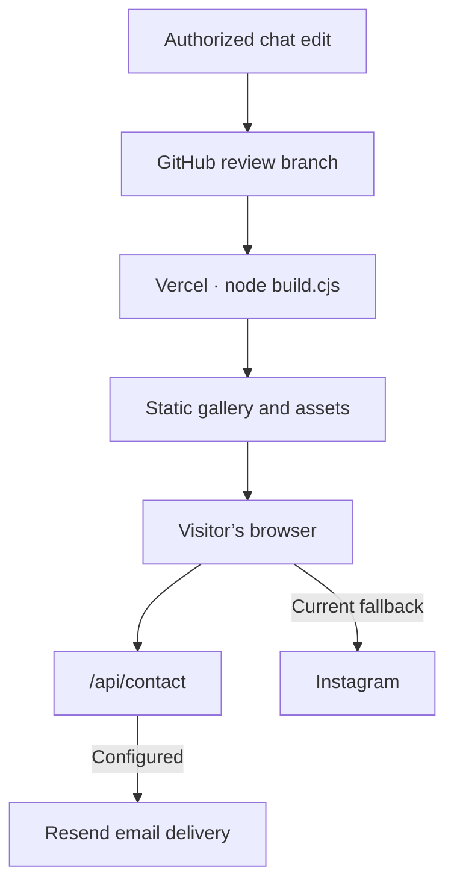

# How the gallery runs
JMD Media | Architecture | Page 1 of 2

## Why Sixteen in the City comes up
Sixteen in the City was the family trip recap and photo album for Scarlett’s Sweet Sixteen in San Francisco. Its publishing setup is the precedent Christine wanted for JMD Media. A gallery layout change on that project went from a GitHub commit to a Vercel deployment. JMD Media has its own repository and review branch, so Josh can review each edit by refreshing one bookmarked link after the build finishes.

## From an edit to a visitor

## Gallery data
Each record in gallery-data.js connects a stable photo ID to its title, alt text, caption and full-size and smaller WebP files. gallery.js uses the same record for the wall and enlarged viewer. Reordering the collection changes the display numbers while preserving the image files.

## Serving the gallery and inquiries
Vercel serves the gallery, About and Inquiries as static pages. The build also supplies the absolute featured-image URL for link previews. Inquiries checks /api/contact for availability. Email delivery uses Resend when configured, with credentials and recipient details held on the server. Instagram is the current contact route.

[Open the gallery preview](https://jmd-gallery-preview.vercel.app/) · [View the review branch](https://github.com/ChristineEberle/jmd-media/tree/preview/josh-gallery-copy)

---
# How to make changes
JMD Media | Editorial and technical options | Page 2 of 2

## Everyday edits from chat
Recommended for captions, credits and replacement photos. Give ChatGPT the display number, current title and desired edit. For a replacement, attach the original. Have it commit to the review branch, run the gallery checks, then verify the signed-out preview. Example: “Replace #17 with this exposure; keep its order and caption.” Swami Dot Exe can use this route when its session has repository write access. Otherwise have it prepare the exact change for a connected ChatGPT session.

## Larger additions and design changes
Use a short-lived branch and pull request for a new gallery, navigation changes or a redesigned viewer. Review its build, then merge into the review branch. Add new photo records and both WebP sizes with matching IDs. A second collection also needs a gallery selection route and its own share metadata. Approve the custom-domain launch separately.

## Direct GitHub edits and recovery
A collaborator with write access can edit a caption in gallery-data.js directly on the review branch. The same deployment process applies. If the result is wrong, revert that commit and verify the new build at the same address. Keep prior versions in Git history. A browser-based editorial form is a later option if repeated bulk updates justify maintaining another interface.

## QA testing after a change
Open the signed-out preview and confirm all 27 photos appear once, with At the edge first. Check the changed photo in the wall and viewer. Test the theme switch, swipe, arrow keys, fixed controls and return navigation. Run the automated phone, tablet and desktop checks. For release, also check captions with Safari’s bars visible on an actual iPhone and verify the share card in iMessage.
